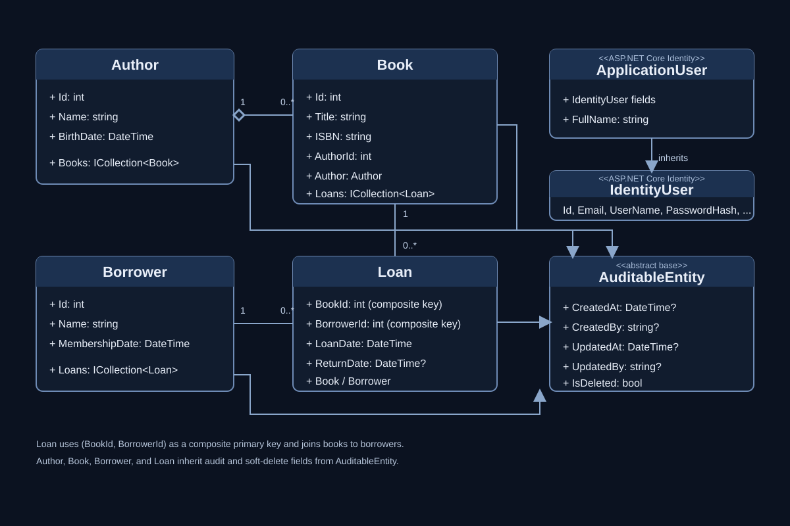

# Library System API

A layered ASP.NET Core Web API for managing a library's authors, books, borrowers, and loans. It includes SQL Server persistence, DTO-based API contracts, role-based authorization, JWT authentication, audit fields, soft deletion, database migrations, and seed data.


## Architecture

The solution separates HTTP handling, business rules, data access, and domain models into four projects:


Controllers call business services through interfaces. Services use repository interfaces for library data, while ASP.NET Core Identity manages authentication users and roles. EF Core configurations define database relationships and constraints.

## Domain model



The database relationship diagram is also available here:


- One `Author` can have many `Book` records.
- A `Book` and a `Borrower` are connected through `Loan` records.
- `Loan` uses the composite key `(BookId, BorrowerId)`.
- `Author`, `Book`, `Borrower`, and `Loan` inherit audit and soft-delete fields from `AuditableEntity`.
- `ApplicationUser` extends ASP.NET Core Identity's `IdentityUser` with `FullName`.

## Solution structure

```text
LibrarySystem.API/                 HTTP API and application startup
  Controllers/                     Account, user, author, book, borrower, and loan endpoints
  Errors/                           Problem-details response factory
  Extensions/                       Dependency injection and database initialization
  Middlewares/                      Exception, request ID, and request timing middleware
  Properties/                       Local launch profiles

LibrarySystem.BLL/                  Business logic and application contracts
  DTOs/                             Request/response models and AutoMapper profiles
  Interfaces/Repositories/          Repository contracts
  Interfaces/Services/              Service contracts
  Results/                          Operation and pagination result types
  Services/                         Library, account, JWT, and user-role services

LibrarySystem.DAL/                  Persistence and infrastructure
  Configurations/                    EF Core entity mappings
  Constants/                         Role names
  Data/                              Library and Identity DbContexts
  Interceptors/                      Audit and soft-delete save interceptors
  Migrations/                        EF Core database migrations
  Repositories/                      EF Core repository implementations
  Seeding/                           Initial library data and Identity roles
  Seeding/SeedData/                  JSON seed files

LibrarySystem.Entities/             Domain entities and shared base classes
Diagrams/                            Class and database diagrams
```

## Implemented components

### Persistence

- `LibraryContext` stores library entities; `AuthenticationContext` stores Identity users and roles.
- Entity configurations define required fields, maximum lengths, unique ISBN values, keys, foreign keys, and delete behavior.
- The generic repository provides common CRUD operations and paginated reads.
- EF Core migrations are applied for both contexts during application startup.

### Interceptors and soft deletion

The `SaveChangesInterceptor` implementations run whenever the library context saves changes:

- `CreatedAtInceptor` sets `CreatedAt` on new auditable entities.
- `UpdatedAtInceptor` refreshes `UpdatedAt` on modified entities.
- `SoftDeleteInceptor` converts entity deletes into updates that set `IsDeleted`.
- EF Core query filters hide soft-deleted authors, books, borrowers, and loans from regular queries.

### Middleware and errors

The API project contains custom middleware for exception handling, request IDs, and request timing. `ExceptionProblemDetailsFactory` creates a consistent problem-details response for unhandled errors. The middleware classes are implemented under `LibrarySystem.API/Middlewares`; add them to the request pipeline in `Program.cs` to activate them.

### DTOs and mapping

Request and response DTOs keep API payloads separate from database entities. AutoMapper profiles map authors, books, borrowers, and loans between entities and DTOs. Account DTOs use validation attributes for input validation.

### Seeding

At startup, the application applies migrations, seeds authors/books/borrowers from JSON when the corresponding tables are empty, and creates the predefined Identity roles if they do not exist.

## Authentication and roles

- `POST /api/account/register` registers a user with the `Member` role.
- `POST /api/account/login` validates credentials and returns a JWT containing the user's role claims.
- Roles are defined in `RoleNames`: `Admin`, `Librarian`, `Member`, and `Viewer`.
- `Admin` is required for user and role-management endpoints.
- The bootstrap administrator is optional. Set `BootstrapAdmin__Email`, `BootstrapAdmin__Password`, and (optionally) `BootstrapAdmin__FullName` in the application environment. On startup, the app creates that account if needed and assigns it the `Admin` role. If the account already exists, its password is not changed.

## API routes

| Area | Route | Purpose |
| --- | --- | --- |
| Account | `POST /api/account/register` | Register a member account |
| Account | `POST /api/account/login` | Sign in and receive a JWT |
| Users | `GET /api/user` | List users and their roles (Admin) |
| Users | `GET /api/user/roles` | List available roles (Admin) |
| Users | `PUT /api/user/{userId}/role` | Assign a role to a user (Admin) |
| Authors | `/api/authors` | Author CRUD operations |
| Books | `/api/books` | Book CRUD operations |
| Borrowers | `/api/borrowers` | Borrower CRUD operations |
| Loans | `/api/loans` | Loan CRUD operations |

Swagger is enabled in the Development environment and accepts JWT bearer tokens through its **Authorize** control.

## Run locally

```bash
dotnet restore "Library System.slnx"
dotnet run --project LibrarySystem.API/LibrarySystem.API.csproj
```

On startup, the API applies both EF Core migration sets and loads the configured seed data. In Development, open the Swagger UI at the URL printed by `dotnet run`.
